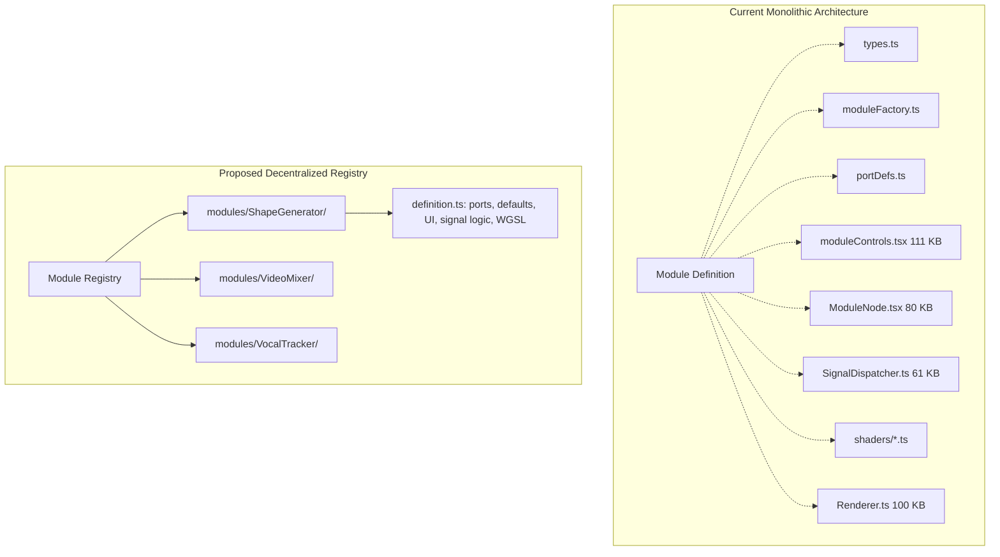

# Terpsichore: Architecture Audit & Resumption Plan (v0.4.0)

**Date:** October 17, 2026  
**Auditor:** Antigravity Engineering Review  
**Project:** Terpsichore (Modular VJ Engine: React 19 + Zustand + WebGPU + Web Audio + Tauri v2)  
**Test Suite Status:** 27/27 Vitest passing (100%)  
**Typecheck Status:** `tsc --noEmit` passing (0 errors)

---

## Executive Summary

Terpsichore is a high-ambition, feature-dense real-time audiovisual synthesizer. It successfully merges GPU-accelerated video synthesis (WebGPU shaders), modular patchbay routing, DSP speech/audio analysis (YIN pitch, LPC vocal formants, Butterworth filtering), and native WebMIDI hardware integration.

However, rapid iterative development across versions **v0.2.0** (Signal Engine 2.0 bypass), **v0.3.0** (Vocal DSP & Formant Tracking), and **v0.4.0** (Hybrid MIDI & Overlays) has left architectural debt and structural friction:
1. **The Four Monoliths:** Over 68% of the codebase resides in four gigantic files totaling ~350 KB: `Renderer.ts` (100 KB, 2,003 lines), `moduleControls.tsx` (111 KB, 2,196 lines), `ModuleNode.tsx` (80 KB, 1,940 lines), and `SignalDispatcher.ts` (61 KB, 1,280 lines).
2. **Partial Bypass Migration:** While `getEffectiveParam()` was introduced to feed the WebGPU renderer directly at 60fps bypassing React, several visual modules (`Pattern`, `Kaleidoscope`, `SampleAndHold`, `Spawn`) were only partially migrated and still read from the throttled 10fps React Zustand store.
3. **The "Source vs. Effect vs. Modulator" Identity Crisis:** The system treats Sources, Effects, and Modulators as fundamentally separate domain models, but graph interaction requires them to behave interchangeably, causing pervasive `(ctx as any).source || (ctx as any).effect` type-hacks.
4. **Lifecycle Leaks & State Fragmentation:** Web Audio nodes are never disconnected upon module deletion; ephemeral `blob:` URLs in exported project files break asset reloading across sessions; and MIDI clock distribution suffers from a reset-on-read race condition.

This audit provides a complete breakdown of current bugs, an annotated feature catalog, a ground-up architectural analysis, and a priority-sorted path to resume development with confidence.

---

## 1. Current Pitfalls & Clear Bugs

| # | Severity | Component | Issue & Impact | File & Location | Verified Solution |
|---|---|---|---|---|---|
| **B1** | **High** | **MIDI Manager** | **Clock Pulse Reset-on-Read Race Condition:** `getClockPulse()` clears `this.clockPulseActive[division] = false` immediately when called. If multiple `MidiInput` modules or modulators query the clock pulse in the same 60fps frame, only the first module receives `true`; all other modules miss the beat completely. | [`src/state/MidiManager.ts:277-283`](file:///c:/Users/Michael/Documents/00%20-%20apps/Terpsichore/src/state/MidiManager.ts#L277-L283) | Replace the reset-on-read boolean with a monotonic `clockTickCount` or frame-ID check so all modules querying within the same tick read the identical pulse state. |
| **B2** | **High** | **WebGPU Renderer** | **Lagging Triggers & Choppy Modulation in Pattern, Kaleidoscope, SampleAndHold, Spawn:** While `getEffectiveParam` bypasses the 10fps React store for continuous parameters, lines 995, 1000, and 1506–1602 in `Renderer.ts` directly read from `layer.signalValues?[...]` instead of `SignalDispatcher.getInstance().getLatestSignals(layer.id)`. This causes dropped trigger hits and 10fps stepped animation on tile counts, mirror triggers, and S&H samples. | [`src/renderer/Renderer.ts:995`](file:///c:/Users/Michael/Documents/00%20-%20apps/Terpsichore/src/renderer/Renderer.ts#L995), [`1506-1602`](file:///c:/Users/Michael/Documents/00%20-%20apps/Terpsichore/src/renderer/Renderer.ts#L1506-L1602) | Update all raw `layer.signalValues?.[...]` lookups in `Renderer.ts` to query `SignalDispatcher.getInstance().getLatestSignals(layer.id)`. |
| **B3** | **High** | **Web Audio Engine** | **Audio Node Resource Leaks on Module Deletion:** `AudioEngine.disconnectNode(nodeId)` was implemented to cleanly disconnect biquad filters, compressors, gain nodes, and ring modulators, but it is **never called** by `store.removeEffect()`. When an audio module is deleted from the graph, its audio nodes, oscillators, and analyzers continue processing in the Web Audio context forever. | [`src/state/AudioEngine.ts:586`](file:///c:/Users/Michael/Documents/00%20-%20apps/Terpsichore/src/state/AudioEngine.ts#L586), [`src/state/store.ts:209-220`](file:///c:/Users/Michael/Documents/00%20-%20apps/Terpsichore/src/state/store.ts#L209-L220) | Invoke `AudioEngine.getInstance().disconnectNode(effectId)` directly within `removeEffect` in `store.ts`. |
| **B4** | **Medium** | **Persistence** | **Ephemeral Blob URLs Break Session Reloads:** Local media files (`VideoFile`, `ImageFile`, `AudioFile`) store browser object URLs (`blob:http://...`). When exported to a `.terp` file and reopened in a fresh browser session or Tauri app restart, all blob URLs are dead and media will not render. | [`src/utils/projectPersistence.ts:15-65`](file:///c:/Users/Michael/Documents/00%20-%20apps/Terpsichore/src/utils/projectPersistence.ts#L15-L65) | For web, store file metadata and notify user to re-link or embed small assets as Base64/ArrayBuffer. For Tauri desktop, store absolute native filesystem paths (`filePath`). |
| **B5** | **Medium** | **Signal Engine** | **Synchronous React Store Mutations Inside 60fps Loop:** In `SignalDispatcher.execute()`, parameter updates from MIDI overrides, StepSequencer transitions, and AudioTransformer bypass triggers invoke `state.updateEffect()` and `state.setSource()`. This triggers full synchronous React component reconciliations during the RAF render loop. | [`src/state/SignalDispatcher.ts:572`](file:///c:/Users/Michael/Documents/00%20-%20apps/Terpsichore/src/state/SignalDispatcher.ts#L572), [`1142-1145`](file:///c:/Users/Michael/Documents/00%20-%20apps/Terpsichore/src/state/SignalDispatcher.ts#L1142-L1145), [`1266`](file:///c:/Users/Michael/Documents/00%20-%20apps/Terpsichore/src/state/SignalDispatcher.ts#L1266) | Keep execution transient states inside internal Dispatcher maps; batch UI state sync strictly via the throttled `shouldCommitToUi` (100ms) interval without direct store mutations on hot frames. |
| **B6** | **Medium** | **UI App Root** | **Dynamic Import on Every Click:** `handlePointerDown` in `App.tsx` calls `import('./state/AudioEngine').then(...)` on every single pointerdown event anywhere in the entire app. | [`src/App.tsx:200-204`](file:///c:/Users/Michael/Documents/00%20-%20apps/Terpsichore/src/App.tsx#L200-L204) | Statically import `AudioEngine` at file top-level, or guard with a one-time boolean `isAudioResumed` flag. |
| **B7** | **Low** | **UI Branding** | **Hardcoded Version Mismatch:** The top navigation bar displays `v0.3.0` while `package.json`, `handover_prompt.md`, and changelogs reflect `v0.4.0`. | [`src/App.tsx:214`](file:///c:/Users/Michael/Documents/00%20-%20apps/Terpsichore/src/App.tsx#L214) | Dynamically import `version` from `package.json` or define a single `APP_VERSION` constant. |
| **B8** | **Low** | **Persistence** | **LocalStorage Layout Coupling:** Node UI positions and accordion collapse states reside in `localStorage['terp_node_layout']`. If a user switches projects or clears browser cache, graph positions revert to default stacked positions. | [`src/utils/projectPersistence.ts:3`](file:///c:/Users/Michael/Documents/00%20-%20apps/Terpsichore/src/utils/projectPersistence.ts#L3) | Store node coordinates and layout directly on `layer.graph` in the project state instead of relying on decoupled localStorage. |

---

## 2. Annotated Feature List

### A. Video & Visual Sources
*   **ShapeGenerator:** **[Fully Implemented]** Procedural 2D SDF shapes (polygons, stars, circles, rectangles) with roundness, star convexity, stroke thickness, edge softness, and rotation.  
    *Recommendation:* Add SDF shape morphing and an internal fill-color modulation port.
*   **VideoFile & VideoURL:** **[Fully Implemented]** HTML5 `<video>` rendered into WebGPU textures via `copyExternalImageToTexture`. Supports looping, speed, playback controls, and scrub bars.  
    *Pitfall:* Uses `blob:` URLs which do not persist across restarts.
*   **WebcamCapture:** **[Fully Implemented]** `navigator.mediaDevices.getUserMedia` feed connected to WebGPU. Device picker in UI.
*   **NoiseSource (Monochrome):** **[Fully Implemented]** GPU fragment shader procedural noise (FBM, Worley, Perlin, White). Scale, evolution, persistence, flow speed.
*   **ColorNoise:** **[Fully Implemented]** High-density RGB noise generator using independent 3D coordinate evaluation per channel.

### B. Visual & Composition Effects
*   **Transform2D:** **[Fully Implemented]** Translate, Scale, Rotation, Spin. Features linked X/Y scale modulation.
*   **VideoMixer:** **[Fully Implemented]** 4-channel composition engine supporting Normal, Add, Screen, and Multiply blend modes, individual alpha sliders, and master gain. Fully handles disconnected lines via fallback black textures.
*   **ColorAdjust & ColorRGB:** **[Fully Implemented]** Hue/Sat/Val/Contrast adjustments and discrete RGB add/multiply channel processors.
*   **LumaKey & LumaSplitter:** **[Fully Implemented]** Keying threshold and 3-way low/mid/high luminance texture splitting.
*   **SimpleFeedback:** **[Fully Implemented]** Ping-pong FBO feedback with zoom, rotation angle, and decay amount.
*   **Pattern:** **[Partially Compromised]** Grid tiling engine with X/Y counts, spacing, and alternate mirroring.  
    *Pitfall:* Modulation inputs read from 10fps React state instead of 60fps bypass.
*   **Kaleidoscope:** **[Partially Compromised]** Radial symmetry mirror with segment count and angle.  
    *Pitfall:* Logarithmic modulation input reads from 10fps React state instead of 60fps bypass.
*   **PixelProcessor:** **[Fully Implemented]** Posterization bit-crusher, thresholding, and Sobel edge detection.
*   **Spawn:** **[Partially Compromised]** Particle/instance generator leveraging WebGPU storage buffers and CPU object tracking.  
    *Pitfall:* Trigger and reset jacks read from 10fps React state instead of 60fps bypass.
*   **Path:** **[Fully Implemented]** Trajectory generator supporting Physics, Wiggle, and Orbit trajectories.

### C. Signal Processing & Logic Modulators
*   **LFO:** **[Fully Implemented]** High-frequency oscillator with Sine, Triangle, Saw, Square waveforms, frequency/amplitude CV, and Phase Reset sync jacks.
*   **Noise (1D Modulator):** **[Fully Implemented]** Stochastic signal generator supporting White, Pink, Brownian, and Perlin algorithms.
*   **TriggerPad:** **[Fully Implemented]** Manual/Keyboard (0-9) trigger generator with optional Attack/Release envelope generator.
*   **StepSequencer:** **[Fully Implemented]** 8 or 16-step CV sequencer with clock rate, shuffle, slew rate, forward/backward/pendulum/random direction modes.
*   **SampleAndHold:** **[Partially Compromised]** Dual-mode S&H with manual trigger, external CV trigger, and live toggle.  
    *Pitfall:* Trigger jacks read from 10fps React state.
*   **LogicGate & TriggeredGate:** **[Fully Implemented]** Boolean operations (AND, OR, XOR, NAND, NOR) and latching/momentary gate toggles.
*   **SignalMath (aka Math):** **[Fully Implemented]** Arithmetic processor (Add, Subtract, Multiply, Divide, Min, Max, Pow).
*   **SignalProcessor:** **[DEAD / RESIDUAL FEATURE]**  
    *Detail:* Predecessor to `SignalMath`. Defined in `types.ts`, `moduleFactory.ts`, `portDefs.ts`, `moduleControls.tsx`, and the dead file `SignalEngine.ts`. It has **no evaluation logic** in `SignalDispatcher.ts`. Adding it produces a non-functional node. *Action: Delete and remove all references.*
*   **InterLayerInput & InterLayerOutput:** **[Fully Implemented]** Cross-layer CV and trigger routing buses (1 to 3 channels).

### D. Audio Analysis & Vocal Synesthesics
*   **AudioSource:** **[Fully Implemented]** Bus listener connecting layer audio into master or sub-buses.
*   **SpectralSplitter:** **[Fully Implemented]** 5-band frequency analysis (Low, LowMid, Mid, HighMid, High) with smoothing, sensitivity, and WebGPU visualizer.
*   **Oscilloscope:** **[Fully Implemented]** Real-time time-domain waveform visualizer with freeze and time-scale controls.
*   **AudioTransformer:** **[Fully Implemented]** Filter + compressor + envelope follower pedal simulation.
*   **AudioModulator:** **[Fully Implemented]** Ring modulator with clean dry and 4 octave multiplier/divider channels.
*   **AudioGate:** **[Fully Implemented]** RMS VU ballistics, 10ms attack constant, discrete Web Audio gate.
*   **SpeechEnvelopeTracker:** **[Fully Implemented]** Real-time speech envelope, continuous onset detection, cadence tracking.
*   **VocalPitchTracker:** **[Fully Implemented]** Autocorrelation YIN pitch detector with parabolic interpolation.
*   **VowelFormantTracker:** **[Fully Implemented]** Order-7 LPC formant estimator with 4th-order Butterworth anti-aliasing filter and voice profiles.
*   **SpokenWordVisualizer (Vocal Console):** **[INTENTIONAL COMPOSITE / PARTIAL STUB]**  
    *Detail:* Successfully acts as an analytical composite routing bay combining Speech Envelope, YIN Pitch, and LPC Formants into 17 output CV signals. However, its declared visual parameters (`renderMode: 'Constellation' | 'FlowingRibbon' | 'RadialWaterfall'`) are **completely unrendered stubs** with no shader implementation in `Renderer.ts`.

### E. MIDI & Hardware Control (v0.4.0)
*   **MidiInput Modulator:** **[Fully Implemented]** Generates Note Out, Gate Out, Velocity Out, CC Out, and Clock Out. (Clock pulse requires Bug B1 fix).
*   **Universal Interactive Learn & Manual Assignment:** **[Fully Implemented]** Hardware learn (wiggler detection) and manual channel/CC mapping.
*   **Inline Jacks & Overlays:** **[Fully Implemented]** Slide-in learn jacks (`🔌`) synced to Zustand `midiOverlayActive`.

### F. Residual & Dead Code Found
1.  [`src/state/SignalEngine.ts`](file:///c:/Users/Michael/Documents/00%20-%20apps/Terpsichore/src/state/SignalEngine.ts): 81 lines of Signal Engine 1.0 code. Completely unimported and unused.
2.  `SignalProcessorSource` & related bindings in `types.ts`, `moduleControls.tsx`, `portDefs.ts`, `moduleFactory.ts`: Completely superseded by `SignalMath`.
3.  `_effect` and `_onUpdate` in `SpokenWordVisualizerUI` in `ModuleNode.tsx`: Prefixed with underscores because visual options are dead stubs.

---

## 3. State of Separation Analysis & Ground-Up Architectural Review

### A. The Core Architectural Conflict: Declarative React vs. 60fps Determinism
The greatest tension in Terpsichore stems from building a real-time 60fps signal-processing environment inside a React + Zustand state tree:
*   **Original Paradigm (v0.1.0):** Every slider move, LFO tick, and trigger was dispatched as a Zustand store action. React re-rendered the UI, and the WebGPU render loop read the updated store.
*   **The Problem:** At 60fps, updating 20+ modulation ports each frame caused continuous reconciliation cascades across hundreds of React DOM nodes, collapsing frame rates to ~15-20fps.
*   **The Hotfix (v0.2.0):** Signal Engine 2.0 introduced the High-Frequency Bypass (`latestSignals` in `SignalDispatcher.ts`), updating in memory every frame, while throttling UI commits to 10fps (`UI_COMMIT_INTERVAL = 100ms`).
*   **The Architectural Consequence:** The codebase now lives in two competing worlds:
    1.  *The Hot World:* High-speed numeric caches (`latestSignals`, `midiOverrides`, `gateOpenStates`).
    2.  *The Cold World:* Zustand store (`layers`, `layer.effects`, `layer.signalValues`).
    Because this was retrofitted, some effects (`getEffectiveParam`) read from the Hot World, while others (`Pattern`, `Kaleidoscope`, `Spawn`, `SampleAndHold`) still reach into the Cold World, resulting in unpredictable latency and dropped trigger events.

### B. The Four Monoliths & Lack of Module Locality
Currently, to add or modify a single module in Terpsichore, an engineer must manually edit **eight separate files**:
1.  [`src/state/types.ts`](file:///c:/Users/Michael/Documents/00%20-%20apps/Terpsichore/src/state/types.ts) (Interface & union types)
2.  [`src/state/moduleFactory.ts`](file:///c:/Users/Michael/Documents/00%20-%20apps/Terpsichore/src/state/moduleFactory.ts) (Default parameter instantiation)
3.  [`src/components/NodeGraph/portDefs.ts`](file:///c:/Users/Michael/Documents/00%20-%20apps/Terpsichore/src/components/NodeGraph/portDefs.ts) (Port definitions and signal types)
4.  [`src/components/NodeGraph/moduleControls.tsx`](file:///c:/Users/Michael/Documents/00%20-%20apps/Terpsichore/src/components/NodeGraph/moduleControls.tsx) (UI sliders and control rows - 111 KB file)
5.  [`src/components/NodeGraph/ModuleNode.tsx`](file:///c:/Users/Michael/Documents/00%20-%20apps/Terpsichore/src/components/NodeGraph/ModuleNode.tsx) (Custom UI rendering exceptions - 80 KB file)
6.  [`src/state/SignalDispatcher.ts`](file:///c:/Users/Michael/Documents/00%20-%20apps/Terpsichore/src/state/SignalDispatcher.ts) (JIT compilation & DSP math - 61 KB file)
7.  [`src/renderer/shaders/<Module>.ts`](file:///c:/Users/Michael/Documents/00%20-%20apps/Terpsichore/src/renderer/shaders) (WGSL shader)
8.  [`src/renderer/Renderer.ts`](file:///c:/Users/Michael/Documents/00%20-%20apps/Terpsichore/src/renderer/Renderer.ts) (Pipeline creation, uniform buffers, render pass execution - 100 KB file)

This is an extreme violation of the **Single Responsibility Principle** and **Feature Locality**. A change to a single slider parameter requires synchronizing property names across 5+ disparate files, explaining why several port names and parameter keys have previously suffered desynchronization bugs (e.g. `scale_x` vs `scaleX`).

### C. The Source / Effect / Modulator Identity Crisis
In `types.ts`, `AnySource` was originally intended for Layer roots (ShapeGenerator, VideoFile, Webcam, etc.), `AnyEffect` for video manipulators, and `modulators` for CV generators.
However, because modular VJs routinely want multiple sources (e.g., blending a Webcam and a Shape Generator in a single layer via a VideoMixer), the system hacked `AnyEffect` to contain all sources, while preserving `layer.source` as a mandatory primary root.
This forces awkward gymnastics throughout the codebase:
*   `const src = <T>(ctx: RowCtx) => ((ctx as any).source || (ctx as any).effect) as T;`
*   `layer.source` is special-cased with the hardcoded node ID `'source'` while all other sources are given UUIDs.
*   `Renderer.ts` must maintain parallel tracking for `primaryMedia` vs `activeLayer.effects`.

### D. Desktop (Tauri v2) vs. Web (Chromium) Parity
*   **Media Assets:** Web relies on ephemeral `blob:` URLs; Tauri requires native filesystem access (`convertFileSrc` or persistent file paths).
*   **Permissions:** Web prompts for Camera/Mic natively; Tauri on Windows/macOS requires platform entitlements in `src-tauri/tauri.conf.json`.
*   **Audio/MIDI:** Web Audio and Web MIDI work out of the box in Chromium. Under Tauri/Webview2 on Windows, Web MIDI requires specific Chromium flags or native backend bindings.

---

## 4. Priority-Sorted Resumption Roadmap

### Tier 1: Critical Bug Fixes & Hot-Path Latency Cleanup (Immediate Resumption)
*These fixes require minimal code changes but immediately eliminate audio/visual glitches, latency, and resource leaks.*

1.  **Fix B1 (MIDI Clock Pulse Race Condition):**
    *   In [`src/state/MidiManager.ts`](file:///c:/Users/Michael/Documents/00%20-%20apps/Terpsichore/src/state/MidiManager.ts), change `getClockPulse(division)` to compare against `this.clockTicks` without wiping `clockPulseActive` on the first caller.
2.  **Fix B2 (Migrate Pattern, Kaleidoscope, SampleAndHold, Spawn to 60fps Bypass):**
    *   In [`src/renderer/Renderer.ts`](file:///c:/Users/Michael/Documents/00%20-%20apps/Terpsichore/src/renderer/Renderer.ts), replace all `layer.signalValues?.[...]` lookups with `SignalDispatcher.getInstance().getLatestSignals(layer.id)`.
3.  **Fix B3 (AudioEngine Resource Leak on Module Deletion):**
    *   In [`src/state/store.ts`](file:///c:/Users/Michael/Documents/00%20-%20apps/Terpsichore/src/state/store.ts) (`removeEffect`), call `AudioEngine.getInstance().disconnectNode(effectId)`.
4.  **Fix B6 & B7 (Micro-performance & Version Cleanups):**
    *   Remove dynamic `import('./state/AudioEngine')` from `App.tsx`'s `pointerdown` listener; update UI header to `v0.4.0`.
5.  **Remove Dead Code:**
    *   Delete unused [`src/state/SignalEngine.ts`](file:///c:/Users/Michael/Documents/00%20-%20apps/Terpsichore/src/state/SignalEngine.ts). Remove defunct `SignalProcessor` references from types, factory, and port definitions in favor of `SignalMath`.

---

### Tier 2: Structural Refactoring & Decentralized Module Registry
*Transforming the Four Monoliths into an extensible, maintainable architecture before adding more modules.*

1.  **Extract Custom Module UIs from `ModuleNode.tsx`:**
    *   Move `AudioGateUI`, `SpeechEnvelopeTrackerUI`, `VocalPitchTrackerUI`, `VowelFormantTrackerUI`, `SpokenWordVisualizerUI`, and `StepSequencerUI` into dedicated files under `src/components/NodeGraph/customNodes/`.
    *   Reduces `ModuleNode.tsx` from 1,940 lines to under 600 lines.
2.  **Split `moduleControls.tsx` by Category:**
    *   Divide the 2,196-line file into domain files: `visualSourceControls.tsx`, `effectControls.tsx`, `audioControls.tsx`, and `modulatorControls.tsx`.
3.  **Modularize `Renderer.ts`:**
    *   Extract Media Element Management (`videoElements`, `audioElements`, `activeStreams`) into a dedicated `MediaManager.ts`.
    *   Extract CPU physics/particle simulation (`Spawn` and `Path` object tracking) into `SimulationPipeline.ts`.
    *   Leaves `Renderer.ts` purely focused on WebGPU pipeline compilation, render passes, and FBO ping-ponging.
4.  **Unify Node Identity (Resolve Source vs Effect):**
    *   Transition toward treating all graph elements as first-class `GraphNode` instances with an input list, output list, and processor type, eliminating special-casing for `'source'`.

---

### Tier 3: Core Module Refinements & Vocal/DSP Polish
*Polishing and completing existing capabilities as highlighted in the v0.4.0 handover prompt.*

1.  **SpokenWordVisualizer Visual Rendering:**
    *   Implement actual WebGPU shaders for the 3 declared render modes: `Constellation` (SDF particle cluster responding to pitch/formant X-Y), `FlowingRibbon` (smooth ribbon responding to cadence and timbre), and `RadialWaterfall` (circular frequency/vowel rings).
2.  **ShapeGenerator Refinements:**
    *   Add color fill modulation inputs (`fill_r`, `fill_g`, `fill_b`, `fill_a`).
    *   Add continuous shape-morphing (SDF blending between circle, polygon, and star).
3.  **VideoMixer UX & Transitions:**
    *   Add a master crossfader A/B bus option in addition to the 4 discrete channel levels.
4.  **Audio Transformer & Modulator Tuning:**
    *   Add dry/wet blend curve options and anti-click smoothing on bypass triggers.

---

### Tier 4: Post-MVP Feature Expansion
*New capabilities from the post-MVP roadmap once the foundation is stabilized.*

1.  **Key-Mixer Compositing Node:**
    *   Luma Keying (luminance thresholds) and Chroma Keying (color keying with green/blue spill suppression) for blending multiple incoming video feeds within a single layer.
2.  **Radial & Jitter Pattern Engine:**
    *   Concentric radial tiling mode, per-tile incremental rotation, and UV video-signal displacement inputs.
3.  **Video Math:**
    *   Algebraic pixel composition between two texture inputs (Add, Subtract, Multiply, Min/Max, Difference).
4.  **Tauri Desktop Native File Handling:**
    *   Persistent project asset loading using native file dialogs and absolute disk paths for VJ sets without browser sandboxing limits.

---

### Tier 5: Non-Priorities (Do Not Resume Yet)
*Features that would be premature or add unnecessary complexity at this stage.*

*   **Cloud Synchronization / Collaborative Sharing:** Premature while project schema and file asset handling are still evolving.
*   **Complex GPU Compute Particle Physics:** CPU-based Spawn/Path with current storage buffer instancing is currently running at 60fps; compute shaders add shader cross-platform complexity without immediate bottleneck pressure.
*   **Full History / Undo-Redo Tree:** Implementing an undo stack before completing the structural module registry refactor will require continuous rewriting.
*   **Mobile / Touch Responsive Layouts:** Terpsichore is a desktop VJ workstation tool requiring dual-screen setup, high-resolution WebGPU, and physical MIDI controllers.
